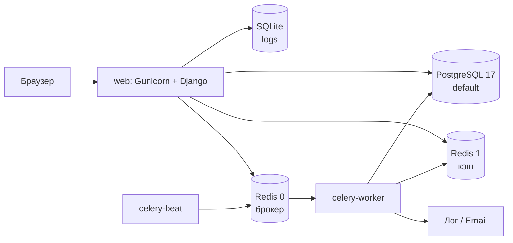

# Medicine Tracker

MVP веб-приложения для учёта лекарств: регистрация и вход пользователя, список препаратов с дозировкой и частотой приёма, создание/редактирование/удаление записей, расписание приёма по времени, статусы приёма и фоновые напоминания.

Интерфейс на русском языке. Документ описывает фактически реализованную конфигурацию проекта, а не исходное задание разработки.

## Оглавление

- [Обзор](#обзор)
- [Стек технологий](#стек-технологий)
- [Архитектура](#архитектура)
- [Структура проекта](#структура-проекта)
- [Модель данных](#модель-данных)
- [API и веб-маршруты](#api-и-веб-маршруты)
- [Быстрый запуск](#быстрый-запуск)
- [Переменные окружения](#переменные-окружения)
- [Фоновые задачи](#фоновые-задачи)
- [Тесты](#тесты)
- [Полезные команды](#полезные-команды)
- [Локальный запуск без Docker](#локальный-запуск-без-docker)
- [Примечания](#примечания)

## Обзор

Пользователь регистрируется или входит, после чего попадает в трекер (`/tracker/`). На странице трекера можно:

- добавить лекарство: название, дозировка, частота приёма;
- задать частоту свободным текстом или указать конкретные времена приёма;
- просматривать карточки лекарств и их расписание;
- редактировать и удалять лекарства;
- переключать статус времени приёма: `Запланировано` → `Выполнено` → `Запланировано`;
- получать отметку `Просрочено`, если время приёма уже прошло (обновляется фоновой задачей).

Все операции с данными выполняются через REST API того же приложения. HTML-страница использует Django-шаблоны и JavaScript `fetch` с CSRF-токеном.

## Стек технологий

| Слой | Технология |
|---|---|
| Backend | Django 6.1, Django REST Framework 3.18 |
| Язык | Python 3.14 (`python:3.14-slim` в Docker) |
| Web-сервер | Gunicorn 23, WhiteNoise 6.8 для статики |
| Основная БД | PostgreSQL 17, драйвер `psycopg[binary]` |
| БД логов | SQLite (`medtracker/logs.sqlite3`) |
| Кэш | Redis 7, виртуальная БД `/1` |
| Очередь задач | Redis 7, виртуальная БД `/0` |
| Фоновые задачи | Celery 5.4 + Celery Beat |
| Фронтенд | Django templates, Bootstrap 6.0.0-alpha.1 (CDN), ванильный JavaScript |
| Аутентификация | Django Auth + сессии + `SessionAuthentication` + CSRF |
| Инфраструктура | Docker, Docker Compose |

## Архитектура



### Компоненты

| Компонент | Ответственность |
|---|---|
| `web` | Отдаёт HTML-страницы и REST API, проверяет сессию и CSRF, пишет в PostgreSQL и SQLite, кэширует список лекарств в Redis |
| `postgres` | Основное хранилище: пользователи Django, лекарства и расписания |
| `redis` | Кэш списка лекарств и брокер сообщений Celery |
| `celery-worker` | Выполняет задачи проверки просроченных приёмов и ежедневного сброса статусов |
| `celery-beat` | Запускает периодические задачи по расписанию |
| `postgres_conf/` | Конфигурация PostgreSQL и SQL-скрипт инициализации дополнительного пользователя/БД |

### Приложения Django

- `apps.main` — главная страница `/`.
- `apps.accounts` — HTML-страницы и API регистрации, входа и выхода.
- `apps.tracker` — лекарства, расписания, журнал действий и Celery-задачи.
- `settings/` — настройки, корневые URL, Celery, роутинг БД, WSGI/ASGI.

### Особенности реализации

- **Изоляция данных:** пользователь видит и изменяет только свои лекарства и расписания.
- **Кэширование:** список лекарств хранится в Redis по ключу `medicines:user:<id>` 15 минут. Изменения через API и фоновые задачи сбрасывают кэш.
- **Два хранилища:** `default` (PostgreSQL) для предметных данных, `logs` (SQLite) для `UserActionLog`. Роутинг задаётся в `settings/db_router.py`.
- **Аудит:** операции create/update/delete лекарства и смена статуса расписания пишутся в `UserActionLog` с JSON `old_data`/`new_data`. Ошибка записи лога не прерывает основную операцию.
- **Отказоустойчивость кэша:** ошибки Redis при чтении/записи/инвалидации логируются, но не ломают запрос.

## Структура проекта

```text
.
├── docker-compose.yaml           # postgres, web, redis, celery-worker, celery-beat
├── docker-compose.override.yaml  # подключение сервисов к внешней сети warp-net
├── Dockerfile.web                # Python 3.14-slim, WORKDIR /web/medtracker
├── entrypoint.sh                 # pip install + migrate (default и logs)
├── requirements.txt              # корневой список зависимостей, монтируется в контейнер
├── .env.example                  # шаблон переменных окружения
├── postgres_conf/
│   ├── postgresql.conf
│   ├── pg_hba.conf
│   └── initdb/01-create-airflow-user.sql
├── scheduler/
│   └── scheduler.py              # зарезервированный файл; активная логика — в Celery
└── medtracker/
    ├── manage.py
    ├── settings/
    │   ├── settings.py
    │   ├── urls.py
    │   ├── celery.py
    │   ├── db_router.py
    │   ├── wsgi.py
    │   └── asgi.py
    ├── apps/
    │   ├── main/
    │   ├── accounts/
    │   └── tracker/
    └── templates/
        ├── layout/
        ├── main/
        ├── accounts/
        └── tracker/
```

## Модель данных

| Модель | БД | Ключевые поля | Назначение |
|---|---|---|---|
| `django.contrib.auth.models.User` | `default` | `username`, `email`, `password` | Учётная запись пользователя |
| `Medicine` | `default` | `name`, `dose`, `frequency`, `user`, `created_at` | Лекарство пользователя |
| `MedicineSchedule` | `default` | `medicine`, `time`, `status` | Время приёма и его статус |
| `UserActionLog` | `logs` | `user_id`, `username`, `action`, `details`, `created_at`, `data` | Журнал действий пользователей |

Значения `MedicineSchedule.status`:

| Значение | Отображение |
|---|---|
| `planned` | Запланировано |
| `completed` | Выполнено |
| `overdue` | Просрочено |

Значения `UserActionLog.action`: `create`, `update`, `delete`, `status_change`.

## API и веб-маршруты

### HTML

| Метод | URL | Назначение |
|---|---|---|
| `GET` | `/` | Главная страница, требуется вход |
| `GET`, `POST` | `/accounts/signup/` | Регистрация, после успеха сразу вход в трекер |
| `GET`, `POST` | `/accounts/login/` | Вход |
| `POST` | `/accounts/logout/` | Выход |
| `GET` | `/tracker/` | Список лекарств пользователя |
| `GET` | `/admin/` | Админка Django |

### REST API

Базовый доступ к API — сессионная аутентификация. Для изменения данных через браузер/API нужны cookie сессии и заголовок `X-CSRFToken`; токены JWT не используются.

| Метод | URL | Назначение | Доступ |
|---|---|---|---|
| `POST` | `/accounts/api/signup/` | Создать пользователя, ответ `201` | `AllowAny` |
| `POST` | `/accounts/api/login/` | Войти, ответ `200` | `AllowAny` |
| `POST` | `/accounts/api/logout/` | Выйти, ответ `204` | `IsAuthenticated` |
| `GET`, `POST` | `/tracker/api/medicines/` | Список и создание лекарств | `IsAuthenticated` |
| `GET`, `PUT`, `PATCH`, `DELETE` | `/tracker/api/medicines/{id}/` | Просмотр, изменение, удаление лекарства | `IsAuthenticated` |
| `GET`, `POST` | `/tracker/api/schedules/` | Список и создание времён приёма | `IsAuthenticated` |
| `GET`, `PUT`, `PATCH`, `DELETE` | `/tracker/api/schedules/{id}/` | Просмотр и изменение времени/статуса | `IsAuthenticated` |

Пример тела запроса для создания лекарства:

```json
{
  "name": "Витамин D3",
  "dose": "2000 МЕ",
  "frequency": "1 раз в день"
}
```

Пример тела запроса для создания времени приёма:

```json
{
  "medicine": 1,
  "time": "09:00"
}
```

## Быстрый запуск

### Требования

- Docker Engine и Docker Compose Plugin.
- Свободные порты `1289` (веб) и `5432` (PostgreSQL).
- Для запуска с корпоративным прокси: доступная сеть `warp-net` и прокси, указанный в `PIP_PROXY`. Для обычного локального запуска прокси можно оставить пустым.

### Шаги

1. Скопируйте шаблон окружения, если `.env` ещё нет:

   Linux / macOS:

   ```bash
   cp .env.example .env
   ```

   Windows PowerShell:

   ```powershell
   Copy-Item .env.example .env
   ```

   Если прокси не используется, установите `PIP_PROXY=` пустым в `.env`.

2. Запустите стек:

   ```bash
   docker compose -f docker-compose.yaml up --build -d
   ```

   Явное указание `-f docker-compose.yaml` намеренно исключает `docker-compose.override.yaml`, который требует внешнюю сеть `warp-net`. Если эта сеть есть и прокси настроен, можно использовать обычный `docker compose up --build -d`.

3. Проверьте статус и логи:

   ```bash
   docker compose -f docker-compose.yaml ps
   docker compose -f docker-compose.yaml logs -f web celery-worker celery-beat
   ```

4. Откройте приложение: <http://localhost:1289/>.

При первом старте `entrypoint.sh` установит зависимости из корневого `requirements.txt` и выполнит миграции сразу для двух БД: `default` и `logs`.

## Переменные окружения

Файл `.env` не коммитится (см. `.gitignore`). Шаблон — `.env.example`.

| Переменная | Значение по умолчанию / пример | Назначение |
|---|---|---|
| `POSTGRES_DB` | `medicine_db` | Имя основной БД |
| `POSTGRES_USER` | `medicine_user` | Пользователь PostgreSQL |
| `POSTGRES_PASSWORD` | `strong_password_123` | Пароль PostgreSQL |
| `POSTGRES_HOST` | `django-postgres` | Хост БД, в Compose — имя сервиса |
| `POSTGRES_PORT` | `5432` | Порт PostgreSQL |
| `REDIS_URL` | `redis://django-redis:6379/1` | Redis для кэша Django |
| `CELERY_BROKER_URL` | `redis://django-redis:6379/0` | Брокер Celery; задаётся по умолчанию в `settings.py` |
| `SECRET_KEY` | `django-insecure-...` | Секретный ключ Django |
| `DEBUG` | `False` | Режим отладки |
| `ALLOWED_HOSTS` | `localhost,127.0.0.1,0.0.0.0` | Разрешённые хосты |
| `PIP_PROXY` | `http://warp-proxy:1080` | Прокси для `pip install` в `entrypoint.sh`; пустое значение = без прокси |

## Фоновые задачи

Задачи определены в `medtracker/apps/tracker/tasks.py`, расписание — в `medtracker/settings/settings.py` (`CELERY_BEAT_SCHEDULE`). Часовой пояс расписания — `UTC`.

| Задача | Расписание | Действие |
|---|---|---|
| `check_overdue_medicines` | Каждые 5 минут | Находит расписания со статусом `planned`, время которых уже прошло, помечает их как `overdue`, пишет предупреждение в лог, при заполненном `user.email` пытается отправить письмо, сбрасывает кэш затронутых пользователей |
| `reset_daily_schedules` | Ежедневно в `00:01 UTC` | Возвращает все `completed`/`overdue` расписания в `planned` и сбрасывает кэш |

Отправка писем идёт через `django.core.mail.send_mail`. Уведомление всегда попадает в логи `celery-worker`; для реальной доставки почты настраивайте стандартные параметры Django `EMAIL_BACKEND`, `EMAIL_HOST`, `EMAIL_PORT` и др.

## Тесты

Тесты находятся в `medtracker/apps/accounts/tests.py` и `medtracker/apps/tracker/tests.py`. Они покрывают HTML- и API-аутентификацию, валидацию, CRUD лекарств и расписаний, изоляцию пользователей, кэш Redis, роутинг двух БД и устойчивость к ошибкам БД логов.

Запуск внутри контейнера:

```bash
docker compose -f docker-compose.yaml exec web python manage.py test
```

Точечный запуск:

```bash
docker compose -f docker-compose.yaml exec web python manage.py test apps.accounts apps.tracker
```

## Полезные команды

```bash
# Собрать и запустить
docker compose -f docker-compose.yaml up --build -d

# Остановить без удаления данных
docker compose -f docker-compose.yaml down

# Остановить и удалить тома PostgreSQL и pip-кэш (данные будут потеряны)
docker compose -f docker-compose.yaml down -v

# Логи веба и фоновых сервисов
docker compose -f docker-compose.yaml logs -f web celery-worker celery-beat

# Создать суперпользователя Django admin
docker compose -f docker-compose.yaml exec web python manage.py createsuperuser

# Применить миграции вручную
docker compose -f docker-compose.yaml exec web python manage.py migrate
docker compose -f docker-compose.yaml exec web python manage.py migrate --database=logs

# Перезапустить приложение и воркеры
docker compose -f docker-compose.yaml restart web celery-worker celery-beat
```

## Локальный запуск без Docker

Потребуется Python 3.14, локальный PostgreSQL и Redis. Значения `POSTGRES_HOST`, `REDIS_URL` и `CELERY_BROKER_URL` должны указывать на локальные сервисы.

```bash
python -m venv .venv
# Windows PowerShell:
.venv\Scripts\Activate.ps1
# Linux / macOS:
source .venv/bin/activate

pip install -r requirements.txt
cd medtracker

python manage.py migrate
python manage.py migrate --database=logs
python manage.py runserver 0.0.0.0:1289
```

В отдельных терминалах из каталога `medtracker/`:

```bash
celery -A settings worker --loglevel=info
celery -A settings beat --loglevel=info
```

## Примечания

- REST API использует сессионную аутентификацию, а не JWT. Клиент должен сохранять cookie и передавать CSRF-токен для `POST`/`PATCH`/`DELETE`.
- Bootstrap подключается через CDN, поэтому для корректного внешнего вида нужен доступ к `cdn.jsdelivr.net`.
- При наличии времён приёма карточка лекарства показывает кнопки-бейджи статусов; без расписания отображается текстовая `frequency`.
- Данные PostgreSQL хранятся в именованном томе `postgres_data`, журнал действий — в `medtracker/logs.sqlite3` (файл игнорируется Git).
- `docker-compose.override.yaml` подключает `web`, `celery-worker` и `celery-beat` к внешней сети `warp-net`; запуск через `-f docker-compose.yaml` позволяет работать без этой сети.
